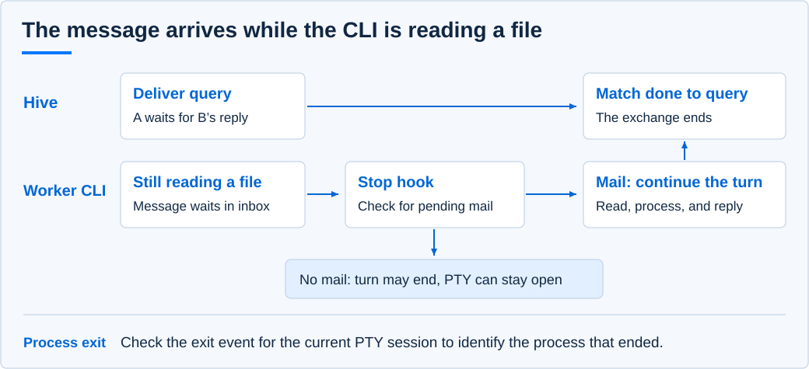

# 信已送达，Worker 何时会处理？

[English](./02-mailbox-and-cli-progress.md) | [繁體中文](./02-mailbox-and-cli-progress-zh-TW.md) | [简体中文](./02-mailbox-and-cli-progress-zh-CN.md)

假设 A 发出一条 `query`，请 B 核对报告里的数字。Router 把消息送进 B 的 inbox 时，B 可能还在读文件。此时平台有了投递记录，A 仍在等答案。如果 A 一看到消息送达就写下结论，它就把投递事件当成了 B 的工作结果。

按照 Hive 对 Claude Worker 的设计，CLI 触发 Stop hook 时会检查邮箱。如果有未读消息，hook 可以要求 CLI 继续工作。如果没有待收消息，这一回合就可以结束，进程仍可保持运行，等待下一次分派。协议只要求接收方回复特定类型的消息，例如 `query`。B 用 `done` 发回结果后，A 就可以结束这次往返。回复次数上限用于处理 Agent 之间不断相互回信的情况。排查时可以分别核对回合的停止信号、最后一条消息的类型及 PTY 退出事件，确认结束的是哪一项。[Hive 协作协议](https://github.com/HarnessMD/munder-difflin/blob/96ae43e3292447f68af6904afb353f6f5bdaa412/HIVE.md)

**待实测**　分别测试空邮箱、一条需要回复的请求和一条完成通知。每次记录 Router 是否投递、hook 收到什么响应、CLI 是否继续工作，以及回合结束后进程是否仍在运行。对比这几次记录，查看哪一次只结束了回合，哪一次已经收到回复，以及进程何时退出。

[返回本节基础篇](./README-zh-CN.md)
