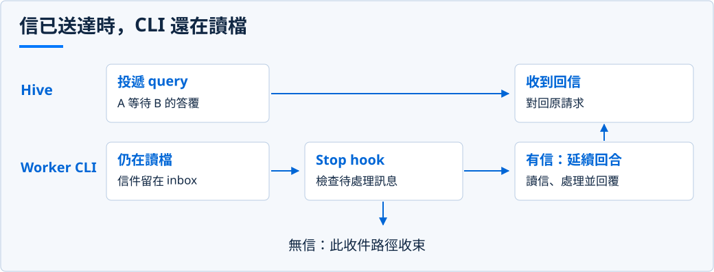

# 信已送達，Worker 何時會處理？

[English](./02-mailbox-and-cli-progress.md) | [繁體中文](./02-mailbox-and-cli-progress-zh-TW.md) | [简体中文](./02-mailbox-and-cli-progress-zh-CN.md)

假設 A 寄了一封 `query`，請 B 核對報告中的數字。Router 把信送進 B 的 inbox 時，B 可能還在讀檔。這時平台有了投遞紀錄，A 仍在等答案。若 A 只因看到信件抵達就往下寫結論，錯誤出在把投遞事件當成工作結果。

依 Hive 對 Claude Worker 的設計，CLI 觸發 Stop hook 時會檢查信箱。有未讀訊息，hook 可以要求繼續工作；沒有待收件，這個回合便可結束，程序仍可留著等待下一次交辦。協定只要求接收端回答特定種類的訊息，例如 `query`。若 B 已用 `done` 回報結果，A 即可收束這次往返。回覆次數上限處理的是 Agent 彼此持續回信的情況。檢查時可分別核對回合的停止訊號、最後一封信的種類及 PTY 退出事件，三者各有自己的終點。[Hive 協作協定](https://github.com/HarnessMD/munder-difflin/blob/96ae43e3292447f68af6904afb353f6f5bdaa412/HIVE.md)

**待實測**　分別提供空信箱、一封需要回覆的請求、一封完成通知。每次記錄 Router 是否投遞、hook 收到何種回應、CLI 是否繼續，以及回合結束後程序是否仍存活。比對哪一次只是結束回合，哪一次已有回信，以及程序何時退出。

[回到本區基礎篇](./README-zh-TW.md)
