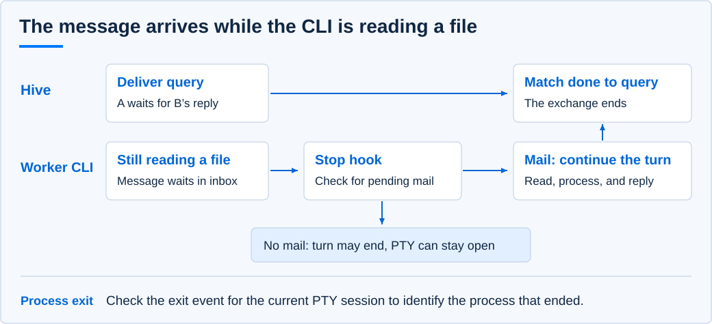

# When will the worker process a delivered message?

[English](./02-mailbox-and-cli-progress.md) | [繁體中文](./02-mailbox-and-cli-progress-zh-TW.md) | [简体中文](./02-mailbox-and-cli-progress-zh-CN.md)

Suppose A sends B a `query` asking it to check a figure in a report. When the router delivers the message to B’s inbox, B may still be reading a file. The platform has a delivery record, and A is still waiting for an answer. If A draws a conclusion from that record alone, it has mistaken delivery for the result of B’s work.

In Hive’s design for Claude workers, the Stop hook checks the mailbox when the CLI invokes it. If there is unread mail, the hook can ask the CLI to keep working. With no mail pending, the turn can end and the process can stay alive for the next assignment. The protocol requires a reply only for certain message types, including `query`. Once B reports the result with `done`, A can close that exchange. The reply limit covers the case where agents keep answering each other. To find out what ended, check the turn’s stop signal, the type of the last message, and the PTY exit event separately. [Hive collaboration protocol](https://github.com/HarnessMD/munder-difflin/blob/96ae43e3292447f68af6904afb353f6f5bdaa412/HIVE.md)

**Still to test.** Try an empty inbox, a request that needs a reply, and a completion notice. For each case, record whether the router delivered a message, what response the hook received, whether the CLI kept working, and whether the process stayed alive after the turn. Compare the runs to see when only the turn ended, when a reply arrived, and when the process exited.

[Back to Multi-Agent Runtime foundations](./README.md)
