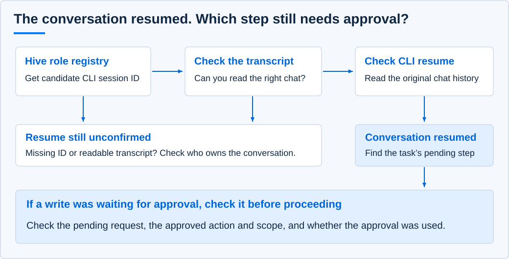

# 平台重启后，凭什么接着执行原任务？

[English](./03-recovery-and-state-evidence.md) | [繁體中文](./03-recovery-and-state-evidence-zh-TW.md) | [简体中文](./03-recovery-and-state-evidence-zh-CN.md)

一位整理报告的 Worker 重启后，可能还记得报告格式，却记不清刚才改到了哪一段。记忆、对话和任务进度保存在不同位置，恢复时需要逐项核对。

| 手头的材料 | 能恢复什么 | 恢复后要核对什么 |
|---|---|---|
| 角色的 `memory.md` | 留给后续回合的知识和偏好 | 这次 Worker 是否实际读到了相关内容 |
| Transcript | 先前记录的消息和工具活动 | 记录属于哪个对话、最后一条是什么，以及工作区里实际留下了什么结果 |
| CLI Session Resume | 由 CLI 恢复它能识别的已有对话 | Provider 是否接受候选 ID，恢复后能否读到原对话 |
| Task 记录 | 原任务、负责人和已登记的进度 | 登记的结果是否存在，下一步由谁执行 |

在本文引用的 Hive 源代码版本中，`recordSession` 按 Agent ID 查找注册记录，检查传入的 Session ID 格式是否符合该 Provider 的要求。如果 ID 发生变化，Hive 会把原值保留为历史候选，并把新值写回注册表。这条路径只会尽力保存：如果找不到注册记录，或者写入失败，就可能没有新记录。读取候选 ID 只是找到了对话线索，接下来还要检查 Transcript 和 CLI 的实际恢复结果。如果中断前正在等待用户批准写入，还需要核对原等待项、批准范围，以及这次批准是否已经用过。[Session 登记与恢复候选](https://github.com/HarnessMD/munder-difflin/blob/96ae43e3292447f68af6904afb353f6f5bdaa412/src/main/hive.ts#L2209-L2245) · [Hive 协作协议](https://github.com/HarnessMD/munder-difflin/blob/96ae43e3292447f68af6904afb353f6f5bdaa412/HIVE.md) · [修复记录](https://github.com/HarnessMD/munder-difflin/blob/96ae43e3292447f68af6904afb353f6f5bdaa412/CHANGELOG.md)

## 进程、输入和任务各查什么？

用户看到 Worker 停在提示符处，准备把下一项工作交给它。此时主进程、终端界面和任务账本各能回答一个不同的问题。

| 判断 | 核对方法 | 容易误判的情况 |
|---|---|---|
| 进程仍在运行 | 找到当前 PTY 对应的进程，核对存活观测和退出事件各自属于哪个进程。 | 旧进程退出时，新进程可能已复用原 PTY ID。 |
| CLI 已空闲，可以接受自动输入 | 检查活动状态和投递条件，包括用户草稿、打开的菜单，以及投递是否已暂停。 | 界面没有新输出时，用户可能正在输入一行尚未写完的文字。 |
| 任务已完成 | 把回信与 Task 对应起来，按分派时的条件核对结果。例如，打开报告确认指定段落已经更新。 | Worker 回复后可以继续运行，也可能在完成任务之前退出。 |

如果漏掉一次 hook 事件，可以先保留最后一次观测的时间和所属 Session，再查看同一 Worker 的收件记录和工作产物，缩小排查范围。查到消息已送达，就记下投递事实。等文件内容也符合验收条件，才有依据更新任务结果。这样既能保留已知进度，也能让值班人员看出还缺哪一段证据。[PTY 创建与退出处理](https://github.com/HarnessMD/munder-difflin/blob/96ae43e3292447f68af6904afb353f6f5bdaa412/src/main/pty.ts#L895-L975) · [终端输入队列约定](https://github.com/HarnessMD/munder-difflin/blob/96ae43e3292447f68af6904afb353f6f5bdaa412/docs/message-queue.md)

## 待实测

用同一个可识别的对话，分别测试 Transcript 存在和缺失的情况。如果重启前曾等待用户批准，再检查等待项的标识、批准范围及其使用记录，然后判断这一步能否继续。

比较三种情况：故意漏掉一次 hook 事件、操作人员留下输入草稿、Worker 报告完成却找不到产物。分别记下界面显示的内容、可用证据，以及操作人员能确认的最终状态。

[返回本节基础篇](./README-zh-CN.md)
