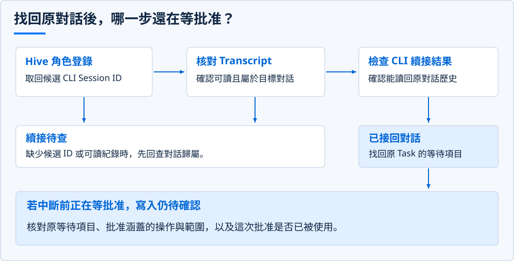

# 平台重啟後，憑什麼接回原任務？

一位整理報告的 Worker 重啟後，仍記得報告格式，卻未必記得剛才改到哪一段。記憶、對話及任務進度各有保存位置，恢復時需要逐一核對。

| 手邊的材料 | 能接回的內容 | 恢復後要核對什麼 |
|---|---|---|
| 角色的 `memory.md` | 留給未來回合的知識與偏好 | 本次 Worker 是否實際讀到相關內容 |
| Transcript | 先前記錄下來的訊息與工具活動 | 所屬對話、最後一筆紀錄及工作區內的實際結果 |
| CLI Session Resume | 由 CLI 接回可辨識的既有對話 | Provider 是否接受候選 ID，接回後是否能讀到原對話 |
| Task 紀錄 | 原交辦、負責人與登記進度 | 已登記的結果是否存在，以及下一步由誰執行 |

在固定版本的 Hive 原始碼裡，`recordSession` 依 Agent ID 找登錄項，檢查傳入的 Session ID 格式是否符合該 Provider。識別碼變更時，原值進入歷史候選，新值寫回登錄。這條寫入路徑採盡力保存，可能因缺少登錄或寫入失敗而沒有新紀錄。讀回候選值只完成尋找對話這一步，後續還要查 Transcript 及 CLI 的續接結果。若中斷前正等待使用者批准寫入，仍須核對原等待項目、批准範圍及批准是否已被使用。[Session 登錄與恢復候選](https://github.com/HarnessMD/munder-difflin/blob/96ae43e3292447f68af6904afb353f6f5bdaa412/src/main/hive.ts#L2209-L2245)、[Hive 協作協定](https://github.com/HarnessMD/munder-difflin/blob/96ae43e3292447f68af6904afb353f6f5bdaa412/HIVE.md)、[修復紀錄](https://github.com/HarnessMD/munder-difflin/blob/96ae43e3292447f68af6904afb353f6f5bdaa412/CHANGELOG.md)

## 程序、輸入與任務各查什麼？

使用者看見 Worker 停在提示列，準備把下一件工作交給它。此時主程序、終端介面與任務帳本各能回答一個不同的問題。

| 判斷 | 核對方式 | 容易誤判的情況 |
|---|---|---|
| 程序仍存活 | 找到目前 PTY 對應的程序，核對存活觀察與退出事件歸屬。 | 舊程序退出時，新程序可能已沿用原 PTY ID。 |
| CLI 已閒置且可接受自動輸入 | 核對活動狀態與投遞條件，包括使用者草稿、開啟中的選單及暫停投遞。 | 畫面沒有新輸出時，使用者可能正在輸入半行文字。 |
| 任務已完成 | 把回信對回 Task，依交辦條件核對結果，例如打開報告確認指定段落已更新。 | Worker 可以在送出回信後繼續存活，也可能在完成前退出。 |

若漏接一次 hook，可先保留最後觀察的時間與 Session 歸屬，再從同一個 Worker 的收件紀錄及工作產物縮小範圍。查到信件已送達，就記下投遞事實；待檔案內容也符合驗收條件，才有依據更新任務結果。這個查證順序能保留已知進度，也讓值班者看出還缺哪一段。[PTY 建立與退出處理](https://github.com/HarnessMD/munder-difflin/blob/96ae43e3292447f68af6904afb353f6f5bdaa412/src/main/pty.ts#L895-L975)、[終端輸入佇列契約](https://github.com/HarnessMD/munder-difflin/blob/96ae43e3292447f68af6904afb353f6f5bdaa412/docs/message-queue.md)

## 待實測

用同一個可辨識的對話分別測試 Transcript 存在與缺失。若重啟前曾等待使用者批准，另查等待識別、核准範圍及其消費紀錄，再判斷是否能繼續該步驟。

比較「刻意缺少一筆 hook」「操作人員留下草稿」「回報完成但找不到產物」三種情況，記下介面顯示、可用證據及人員能確認的最終狀態。

[回到本區基礎篇](./README-zh-TW.md)
