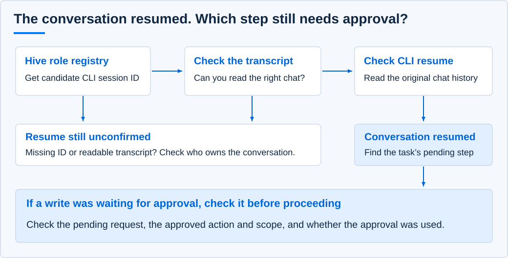

# What does the platform need to resume a task after a restart?

[English](./03-recovery-and-state-evidence.md) | [繁體中文](./03-recovery-and-state-evidence-zh-TW.md) | [简体中文](./03-recovery-and-state-evidence-zh-CN.md)

A worker that restarts while editing a report may remember the report format and still have no idea which paragraph it last changed. Memory, conversation history, and task progress each have their own record to check during recovery.

| Available evidence | What it can restore | What to verify after recovery |
|---|---|---|
| The role’s `memory.md` | Knowledge and preferences saved for future turns | Did this worker actually read the relevant passage? |
| Transcript | Previously recorded messages and tool activity | Which conversation does it belong to? What is the last entry, and what result can you find in the workspace? |
| CLI session resume | An existing conversation the CLI recognizes | Did the provider accept the candidate ID? Can the CLI read the original history after resuming? |
| Task record | The original assignment, its owner, and recorded progress | Does the recorded result exist, and who is responsible for the next step? |

In the pinned Hive source, `recordSession` looks up the registry entry by Agent ID and checks whether the incoming session ID matches the provider’s expected format. If the ID has changed, Hive keeps the previous value among the historical candidates and writes the new one to the registry. Persistence is best effort. A missing entry or failed write can leave Hive without an updated record. Reading back a candidate ID gives you a conversation to look for. Check its transcript and what the CLI resumed. If the worker was waiting for the user to approve a write, also check the original pending request, the scope of the approval, and whether it has already been used. [Session registry and resume candidates](https://github.com/HarnessMD/munder-difflin/blob/96ae43e3292447f68af6904afb353f6f5bdaa412/src/main/hive.ts#L2209-L2245) · [Hive collaboration protocol](https://github.com/HarnessMD/munder-difflin/blob/96ae43e3292447f68af6904afb353f6f5bdaa412/HIVE.md) · [Changelog](https://github.com/HarnessMD/munder-difflin/blob/96ae43e3292447f68af6904afb353f6f5bdaa412/CHANGELOG.md)

## How do you check the process, input, and task?

A user sees a worker at a prompt and wants to give it another assignment. The main process, terminal interface, and task ledger each answer a different question.

| Question | What to check | What can mislead you |
|---|---|---|
| Is the process still alive? | Find the process that the PTY currently points to. Check which process the liveness observation and exit event refer to. | By the time an old process exits, a new one may already have its PTY ID. |
| Is the CLI idle and ready for automated input? | Check activity and delivery conditions, including a user draft, an open menu, or paused delivery. | The terminal can be quiet while the user is halfway through typing a line. |
| Is the task complete? | Match the reply to the task and check the result against the assignment. For example, open the report and verify that the requested paragraph changed. | A worker can stay alive after replying or exit before finishing the job. |

If you miss a hook event, keep the time of the last observation and the session it belongs to. Check the same worker’s incoming messages and work products to narrow down what happened. If the message arrived, record the delivery. Once the file contents meet the acceptance criteria, you have evidence to update the task result. This lets the next operator see both the confirmed progress and what still needs checking. [PTY creation and exit handling](https://github.com/HarnessMD/munder-difflin/blob/96ae43e3292447f68af6904afb353f6f5bdaa412/src/main/pty.ts#L895-L975) · [Terminal input queue contract](https://github.com/HarnessMD/munder-difflin/blob/96ae43e3292447f68af6904afb353f6f5bdaa412/docs/message-queue.md)

## Still to test

Use the same identifiable conversation for two tests, one with the transcript present and one with it missing. If the worker was waiting for user approval before the restart, check the pending request ID, the scope of approval, and the record of its use before deciding whether that step can proceed.

Compare three cases: a deliberately omitted hook event, a draft left in the terminal by an operator, and a worker that reports completion but whose work product cannot be found. Record what the interface shows, what evidence is available, and which final state an operator can confirm in each case.

[Back to Multi-Agent Runtime foundations](./README.md)
